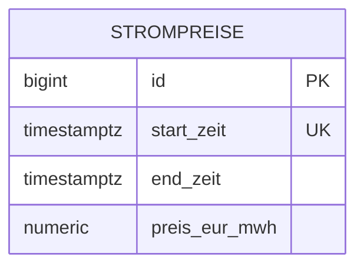

# Strom-Tracker

Spring-Boot-Backend, das stündlich Day-Ahead-Strompreise der aWATTar-API (Deutschland) in PostgreSQL speichert und Auswertungen per REST bereitstellt.

## Technologien

Java 21, Spring Boot, Spring Data JPA, PostgreSQL 16, Flyway, Docker Compose

## Starten

```bash
docker compose up -d
./mvnw spring-boot:run
```

Beim Start und danach stündlich werden die Preise importiert.

## Endpunkte

| Methode | Pfad | Beschreibung |
|---|---|---|
| GET | `/preise` | Alle gespeicherten Preise |
| GET | `/preise/guenstigste?stunden=3` | Günstigste Stunden der nächsten 24 h |
| GET | `/preise/wochentag` | Durchschnittspreis pro Wochentag |
| POST | `/preise/import` | Import manuell auslösen |

```bash
curl "http://localhost:8080/preise/guenstigste?stunden=3"
```

## Datenmodell



## Design-Entscheidungen

- **Flyway** verwaltet das Schema als versionierte SQL-Migrationen.
- **`TIMESTAMPTZ`** speichert Zeitpunkte zeitzonensicher in UTC.
- **UNIQUE auf `start_zeit` + `ON CONFLICT DO NOTHING`**: Der Import ist idempotent und darf beliebig oft laufen.
- **Index auf `start_zeit`** für Zeitbereichsabfragen.

## Was ich gelernt habe / nächste Schritte

- Integrationstests mit Testcontainers
- Preise in lokaler Zeitzone auswerten, Caching der Abfragen